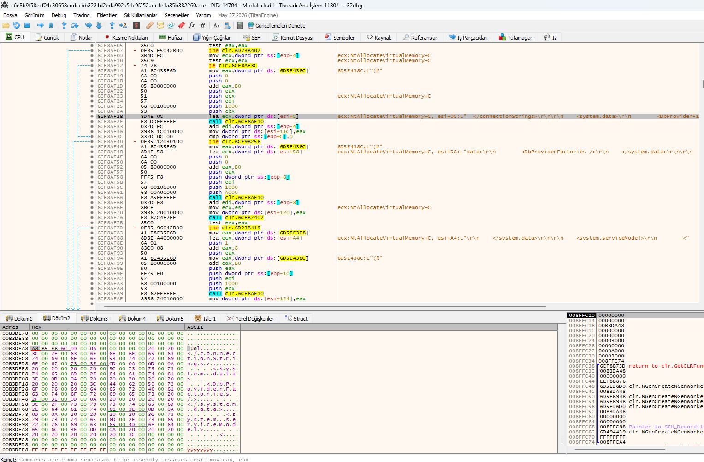
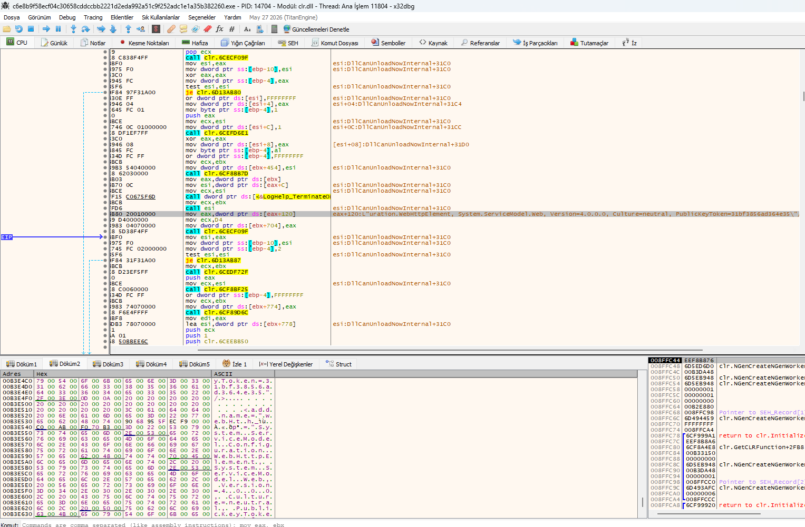
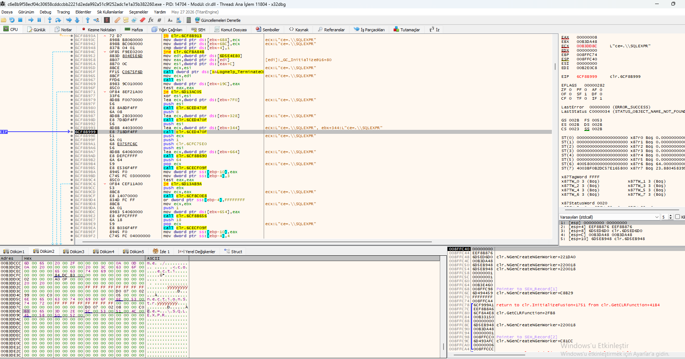
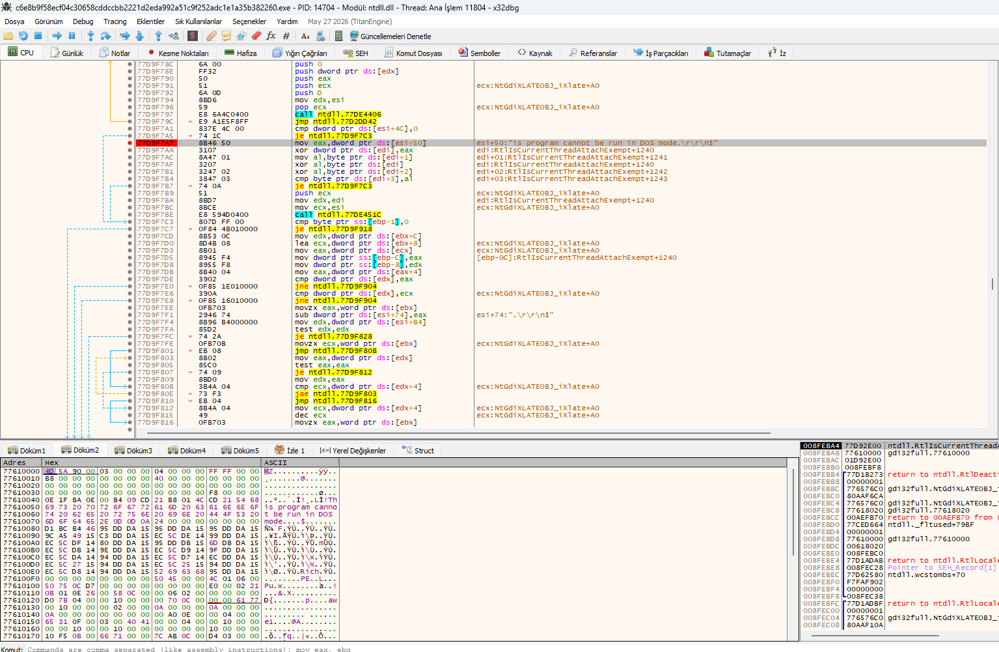
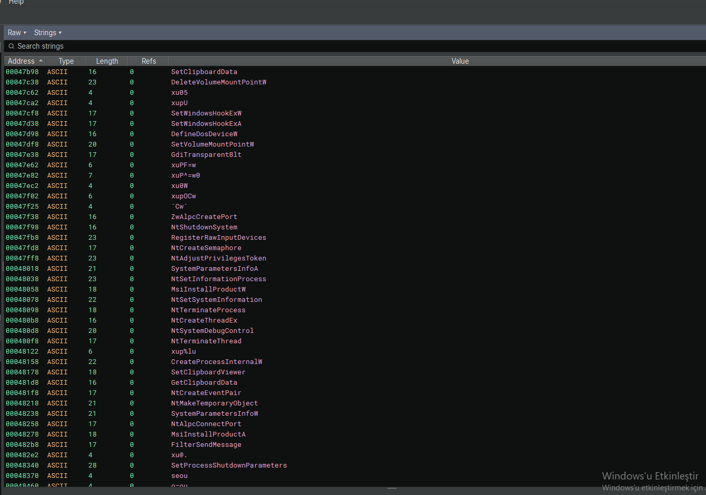

## 1. x32dbg – Encrypted Configuration Decryption & Memory Allocation

The x32dbg memory dump reveals that Formbook decrypts its configuration data and allocates memory for it using `NtAllocateVirtualMemory`.

### Key Observations:

- **`NtAllocateVirtualMemory`** – Allocates memory for the decrypted payload.
- **`mov edx, dword ptr ds:[esi+1C]`** – Retrieves the size of the encrypted data from the ESI register.
- **`push 0x1000`** – Uses `MEM_COMMIT` to allocate memory.
- **`push 0`** – Specifies the allocation type or protection flag.
- **`mov edx, dword ptr ds:[esi+4]`** – Retrieves another configuration value.
- **`lea ecx, [ebp-4]`** – Loads a pointer to a local variable.
- **`test ecx, ecx`** – Checks if the pointer is valid.
- **`mov ecx, [esi+1C]`** – Retrieves the encrypted data size again.
- **`push 0x1000`** – Repeats the `MEM_COMMIT` flag.
- **`push 0`** – Repeats the allocation flag.

### Lower Dump Section:

- **`ConnectionStrings`** – .NET configuration key for C2 addresses.
- **`system.data`, `DbProviderFactories`** – .NET configuration sections (likely decoy).
- **`system.serviceModel`** – .NET service model section.
- **`<DbProviderFactories />`** – Empty XML element (decoy).

### Why This Matters:

- **Configuration Decryption:** Formbook decrypts its config in memory.
- **C2 Addresses:** `ConnectionStrings` likely contains C2 URLs.
- **Evasion:** The use of .NET configuration keywords helps avoid detection.

### Visual Reference:

*x32dbg view showing `NtAllocateVirtualMemory` and `ConnectionStrings` decryption.*

## 2. x32dbg – .NET Assembly Manipulation, XOR Decryption & CLR Initialization

This x32dbg view reveals that Formbook uses .NET assembly manipulation, XOR-based decryption, and CLR (Common Language Runtime) initialization to execute its payload.

### Key Observations:

- **`xor eax, eax`** – Clears EAX, indicating XOR-based decryption.
- **`call 0x6C6E7F60`** – Calls a decryption or processing function.
- **`call 0x6C6EE8B0`** – Calls another processing function.
- **`DllCanUnloadNowInternal`** – Manages .NET assembly loading/unloading.
- **`PublicKeyToken=31bf3856ad364e35`** – Impersonates a Microsoft assembly.
- **`system.serviceModel`** – .NET service model configuration (C2 communication).
- **`System.Web`** – .NET web configuration (HTTP-based C2).
- **`clr.NGenCreateNGenWorker`** – Creates a .NET Native Image Generator worker.
- **`clr.GetCLRFunction`** – Retrieves CLR functions.
- **`return to clr.Initialize`** – Initializes the .NET runtime.

### Why This Matters:

- **XOR Decryption:** The `xor eax, eax` and subsequent `call` functions confirm XOR-based decryption.
- **.NET Execution:** Formbook uses the CLR to run its payload.
- **Impersonation:** The `PublicKeyToken` makes it look like a Microsoft assembly.
- **C2 Configuration:** `system.serviceModel` and `System.Web` store C2 settings.

### Visual Reference:

*x32dbg view showing XOR decryption, `DllCanUnloadNowInternal`, and CLR initialization.*

## 3. x32dbg – SQLExpress Decoy & CLR Initialization

This x32dbg view reveals that Formbook uses a `SQLExpress`-related string as a decoy and initializes the .NET CLR to execute its payload.

### Key Observations:

- **`L"ce=..\SQLEXPR"`** – A decoy string, not related to SQL data theft. It is used to make the malware look like a legitimate SQL Server Express component
- **`clr.InitializeFusion`** – Initializes the .NET Fusion assembly loader, which is used to load the .NET payload into memory.
- **`clr.GetCLRFunction`** – Retrieves CLR functions to execute managed code.
- **`clr.NGenCreateNGenWorker`** – Creates a .NET Native Image Generator worker, allowing the payload to run without JIT compilation.
- **`return to clr.InitializeFusion+1751`** – Returns to the CLR initialization routine.

### Why This Matters:

- **Impersonation:** The `SQLEXPR` string is a decoy to evade detection by security tools.
- **.NET Execution:** Formbook uses the CLR to load and run its payload directly in memory
- **Evasion:** CLR initialization helps the malware bypass static analysis.

### Visual Reference:

*x32dbg view showing `L"ce=..\SQLEXPR"`, `clr.InitializeFusion`, and CLR functions.*

## 4. x32dbg – Payload Start & XOR Decryption Loop

This x32dbg view reveals the start of Formbook's payload, located after the standard PE DOS stub message. The malware uses a XOR decryption loop to decrypt its payload in memory.

### Key Assembly Instructions:

- **`This program cannot be run in DOS mode`** – Standard PE DOS stub message.
- **`xor dword ptr ds:[edi], eax`** – XORs the data at EDI with EAX (decryption).
- **`mov al, byte ptr ds:[edi+1]`** – Loads a byte from EDI+1 into AL.
- **`xor al, byte ptr ds:[edx+1]`** – XORs AL with the byte at EDX+1 (decryption key).
- **`mov byte ptr ds:[edi], al`** – Writes the decrypted byte back to EDI.
- **`call ntdll.77DDE45C`** – Calls `RtlIsCurrentThreadAttachExempt` (anti-debug).
- **`cmp dword ptr ds:[esi+4], 0`** – Checks if the counter (ESI+4) is zero.
- **`sub dword ptr ds:[esi+4], eax`** – Decrements the counter.
- **`test edx, edx`** – Tests EDX for zero.
- **`jne ntdll.77DDF9F4`** – Loops back if not zero (decryption loop).

### Why This Matters:

- **Payload Start:** The payload begins after the standard PE DOS stub.
- **XOR Decryption:** Formbook decrypts its payload in memory using XOR.
- **Anti-Debug:** Calls `RtlIsCurrentThreadAttachExempt` to evade debuggers.
- **Loop:** The decryption loop continues until the counter reaches zero.

### Visual Reference:

*x32dbg view showing the XOR decryption loop after the standard PE DOS stub message.*

## 5. Binary Ninja – Keylogger, Clipboard & Privilege Escalation APIs

Binary Ninja analysis of the extracted payload reveals a comprehensive list of APIs used by Formbook for keylogging, clipboard hijacking, and privilege escalation.

### Key APIs Observed:

- **Clipboard Hijacking:** `SetClipboardData`, `GetClipboardData` – steals and replaces clipboard data.
- **Keylogger:** `SetWindowsHookExW`, `SetWindowsHookExA` – installs keyboard hooks.
- **Process Manipulation:** `NtSetInformationProcess`, `NtCreateThreadEx`, `NtTerminateProcess`.
- **Privilege Escalation:** `NtAdjustPrivilegesToken` – adjusts token privileges.
- **System Control:** `NtShutdownSystem`, `SystemParametersInfoA/W`.
- **Persistence:** `MsInstallProductW/A` – installs a product for persistence.
- **Execution:** `CreateProcessInternalW` – creates a new process.

### Why This Matters:

- **Keylogging:** Captures every keystroke (passwords, messages).
- **Clipboard Theft:** Steals copied crypto addresses and passwords.
- **Privilege Escalation:** Gains higher privileges for deeper system access.
- **Persistence:** `MsInstallProductW/A` ensures the malware runs on startup.

### Visual Reference:

*Binary Ninja view showing keylogger, clipboard, and privilege escalation APIs.*

## Conclusion

This analysis uncovered Formbook, a sophisticated info-stealer that uses encrypted configuration, .NET assembly manipulation, XOR decryption, and keylogging/clipboard hijacking.

### Key Takeaways:

- **Encrypted Configuration:** Decrypts its config in memory using `NtAllocateVirtualMemory`.
- **.NET Assembly Manipulation:** Uses `DllCanUnloadNowInternal` and `PublicKeyToken` to impersonate Microsoft assemblies.
- **CLR Initialization:** Uses `clr.InitializeFusion` and `clr.NGenCreateNGenWorker` to run its .NET payload.
- **SQLExpress Decoy:** Uses `L"ce=..\SQLEXPR"` as a decoy to evade detection.
- **Payload Decryption:** Uses XOR decryption loop after the PE DOS stub.
- **Keylogging & Clipboard Theft:** Uses `SetWindowsHookExW`, `SetClipboardData`, and `GetClipboardData`.
- **Privilege Escalation:** Uses `NtAdjustPrivilegesToken` for elevated access.

### Detection Recommendations:

- Monitor for `NtAllocateVirtualMemory` and `ConnectionStrings` in memory.
- Detect `DllCanUnloadNowInternal` and CLR initialization from unusual processes.
- Monitor for `SetWindowsHookExW` and `SetClipboardData` calls.
- Check for `NtAdjustPrivilegesToken` and `NtCreateThreadEx` usage.

### Sample Download

The analyzed Formbook sample is available on MalwareBazaar for those who wish to conduct their own analysis:

🔗 **[Formbook Sample on MalwareBazaar](https://bazaar.abuse.ch/sample/c6e8b9f58ecf04c30658cddccbb2221d2eda992a51c9f252adc1e1a35b382260)**

**Tools Used:** x64dbg, Binary Ninja
